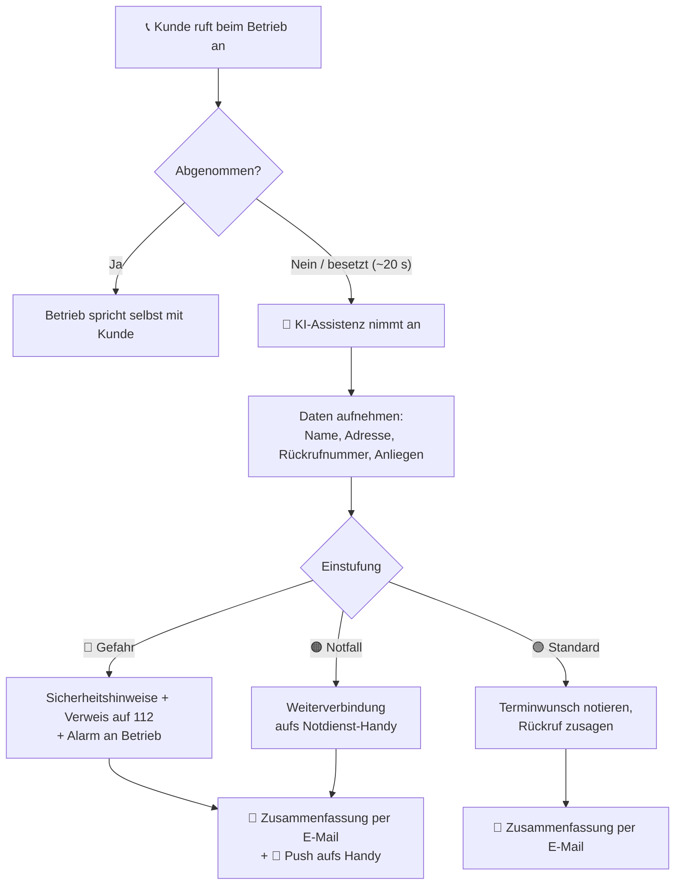

# secretary. – KI-Telefonsekretariat für SHK-Betriebe

> **Kein Anruf geht mehr verloren.** secretary. nimmt Anrufe an, wenn im Betrieb niemand ans Telefon kommt, erkennt Notfälle und schickt nach jedem Gespräch eine saubere Zusammenfassung.

🌐 **Website:** [secretary-bremen.de](https://secretary-bremen.de) · ✉️ **Kontakt:** hallo@secretary-bremen.de

> ℹ️ Dies ist ein **Showcase-Repository**. Der Quellcode von secretary. ist proprietär und nicht öffentlich. Hier werden Idee, Funktionsweise und Architektur des Produkts vorgestellt.

---

## Das Problem

Sanitär-, Heizungs- und Klimabetriebe (SHK) stehen den Großteil des Tages auf der Baustelle oder sind im Einsatz. Das Telefon klingelt trotzdem – und jeder verpasste Anruf ist potenziell ein verlorener Auftrag oder, schlimmer, ein Notfall, der nicht rechtzeitig ankommt.

## Die Lösung

secretary. ist eine KI-Assistenz, die als Telefonsekretariat einspringt:

- 📞 **Rufumleitung:** Wird nicht abgenommen oder ist besetzt, landet der Anruf nach ca. 20 Sekunden bei der KI.
- 🗣️ **Annahme:** Die Assistenz meldet sich mit dem Firmennamen, gibt sich transparent als KI zu erkennen und nimmt Name, Adresse, Rückrufnummer und Anliegen auf.
- 🚨 **Notfallerkennung in drei Stufen** (siehe unten).
- 📧 **Zusammenfassung:** Nach jedem Anruf eine E-Mail mit allen Angaben und anklickbarer Rückrufnummer – bei Notfällen zusätzlich eine Nachricht aufs Handy.
- 🔌 **Keine neue Software:** Betriebe behalten ihre Nummer und ihre bestehende Telefonanlage.

## Notfallerkennung

| Stufe | Beispiele | Reaktion |
|---|---|---|
| 🔴 **Gefahr** | Gasgeruch, Abgas, Feuer | Sofortige Sicherheitshinweise, Verweis auf die 112, Alarm an den Betrieb |
| 🟠 **Notfall** | Rohrbruch, Heizungsausfall bei Frost | Name, Adresse und Nummer aufnehmen, direkte Weiterverbindung aufs Notdienst-Handy |
| 🟢 **Standard** | Wartung, Angebot, Rückfrage | Vollständig aufnehmen, Terminwunsch notieren, Rückruf zusagen |

## Ablauf eines Anrufs



## Beispiel-Zusammenfassung

*(fiktive Daten)*

```text
Betreff: Neuer Anruf – Wartung Gastherme (Standard)

Anrufer:      Max Mustermann
Adresse:      Musterstraße 1, 28195 Bremen
Rückruf:      0421 1234567  ← anklickbar
Anliegen:     Jährliche Wartung der Gastherme
Terminwunsch: nächste Woche, vormittags
Einstufung:   🟢 Standard – Rückruf zugesagt
```

## Bewusste Grenzen

Die Assistenz ist auf Zuverlässigkeit ausgelegt, nicht darauf, alles zu können:

- ❌ nennt **keine Preise**
- ❌ stellt **keine Diagnosen**
- ❌ vereinbart **keine festen Termine** – die Entscheidung bleibt beim Betrieb
- ✅ gibt sich immer **als KI zu erkennen**

## Umsatz-Rechner

Auf der Website gibt es einen kleinen Rechner, der zeigt, was verpasste Anrufe kosten können:

```
Monatlicher Umsatzverlust = verpasste Anrufe/Woche × 4,33 × Auftragsquote × Ø Auftragswert
```

Die Berechnung läuft vollständig im Browser – es werden keine Daten übertragen.

## Status

🚧 **Pilotphase (2026):** Wir suchen 5 SHK-Pilotbetriebe in Bremen für einen kostenlosen 30-Tage-Test mit persönlicher Einrichtung vor Ort und wöchentlichen Abstimmungen.

## Team

**secretary. – Manuel Seeger & Anna Böttcher GbR**, Bremen

- Manuel Seeger – [@mjseeger](https://github.com/mjseeger)
- Anna Böttcher

---

© 2026 secretary. – Manuel Seeger & Anna Böttcher GbR. Alle Rechte vorbehalten.
